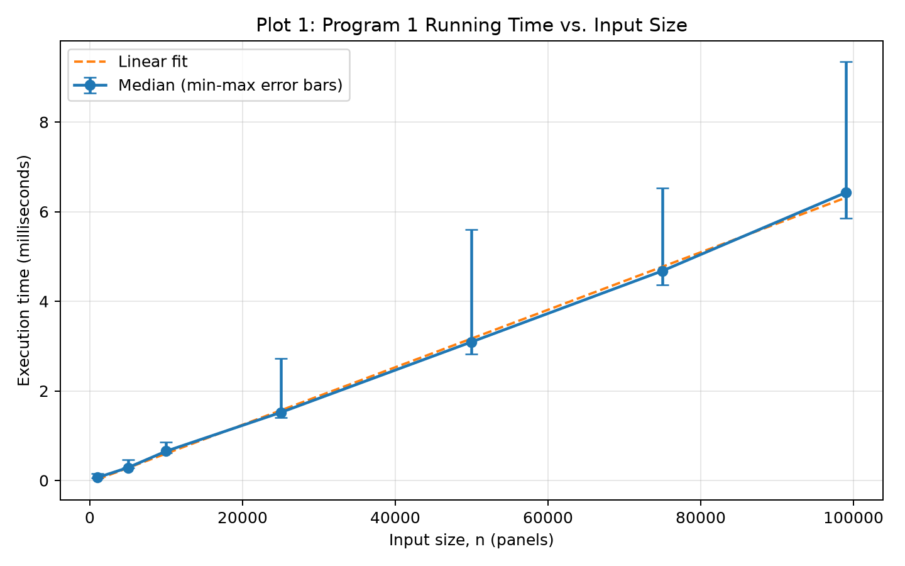
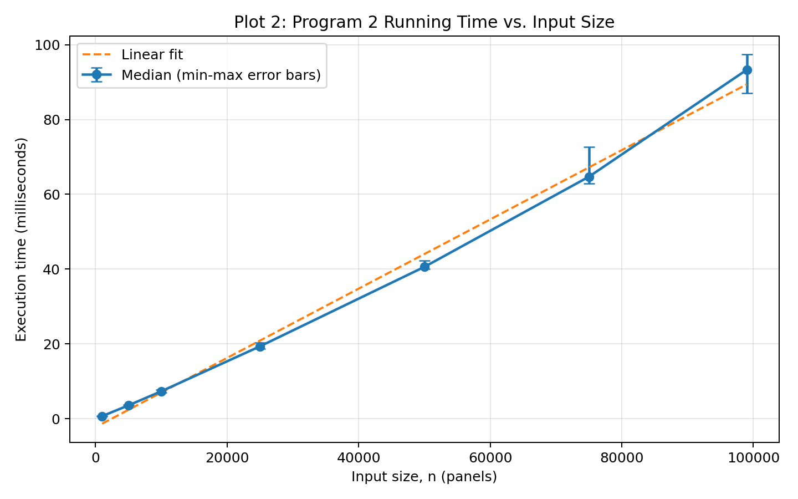

# Algo Project

This repository contains two greedy solutions for the panel-jumping problem and
the scripts used to generate the submitted performance plots. The instructions
below start from a fresh clone and reproduce the correctness checks and timing
results.

## Requirements

- Python 3.10 or newer
- `matplotlib` (needed only for the benchmark plots)

No external package is required to run the algorithms or the unit tests. To
install the plotting dependency, run this from the repository root:

```bash
python -m pip install matplotlib
```

On Windows, use `py` instead of `python` if that is the name of your Python
launcher.

## Run the programs

Each program reads two lines from standard input:

1. `n k`, where `n` is the number of panels and `k` is the maximum jump length.
2. Exactly `n` space-separated panel costs.

For example, run Program 1 with:

```bash
python program1.py
```

Or run Program 2 with the assignment example:

```bash
python program2.py
```

Then enter:

```text
10 4
1 2 4 9 12 10 6 4 3 1
```

The output is the total cost, the number of visited panels, and then one
visited panel index per line. For the Program 2 example above, the expected
output is:

```text
11
3
3
7
10
```

`main.py` is also available as an interactive menu that lets you select either
program:

```bash
python main.py
```

## Run the correctness tests

From the repository root, run:

```bash
python -m unittest discover -s tests -v
```

The suite checks Program 2 against an independent exhaustive solver on small
inputs, checks all committed generated S2 datasets, covers edge cases, and
verifies the command-line output contract.

The committed inputs in `tests/generated/` are sufficient to run the tests. To
recreate those deterministic S1 and S2 files before testing, run:

```bash
python tests/test_generator.py
```

## Reproduce the performance results

Run both benchmark scripts from the repository root:

```bash
python benchmarks/benchmark_program1.py
python benchmarks/benchmark_program2.py
```

Each size receives 3 warm-up runs followed by 15 measured runs. Input creation,
correctness checks, CSV writing, and plotting are outside the timed region. The
scripts plot the median runtime, with the measured minimum and maximum shown as
error bars. Randomly generated benchmark inputs use fixed, size-specific seeds,
so the input data is reproducible; exact timings will vary by computer and by
system load.

The commands overwrite or create these artifacts:

- `benchmarks/results/program1_benchmark.csv`
- `benchmarks/results/plot1_program1.png`
- `benchmarks/results/program2_benchmark.csv`
- `benchmarks/results/plot2_program2.png`
- `benchmarks/results/program2_performance.md`

For a quicker smoke test, reduce the number of measured and warm-up runs and
write the outputs to a separate directory:

```bash
python benchmarks/benchmark_program1.py --repeats 2 --warmups 1 --output-dir benchmarks/smoke-results
python benchmarks/benchmark_program2.py --repeats 2 --warmups 1 --output-dir benchmarks/smoke-results
```

## Performance study

### Plot 1: Program 1

Program 1 was measured from 1,000 through 99,000 panels with `k = 3`. The
submitted median runtime increased from 0.0648 ms at `n = 1,000` to 6.4261 ms
at `n = 99,000`. The linear fit had an R² of approximately 0.9991, consistent
with the expected Θ(n/k) behavior when `k` is constant.



### Plot 2: Program 2

Program 2 used the same input sizes with `k = ceil(n / 10)`, as suggested by
the project instructions. Its measured runtime also increased approximately
linearly with input size, consistent with its Θ(n) implementation.


